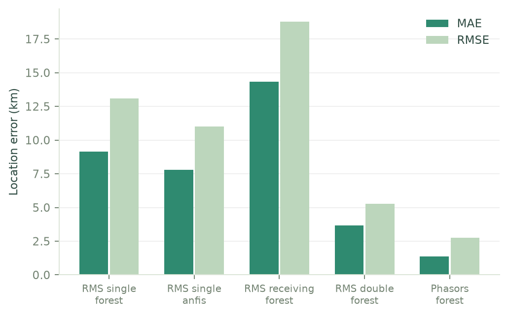

# GridFault Lab

**A working first version of measurement-aware transmission-line fault diagnosis.**

[Open the live workbench](https://snow-warrior07.github.io/GridFault-Lab/) · [Full project explanation](docs/PROJECT_GUIDE.md) · [Measured results](results/SUMMARY.md) · [Data card](docs/DATA_CARD.md)

Provide the available voltage/current measurements at buses 7 and 8. The app selects a supported measurement profile, identifies healthy/internal/external events, classifies internal faults, and estimates distance when its checks pass. Real trained models run entirely in your browser; uploaded measurements are not sent to a server.

This is a **synthetic, fundamental-frequency research benchmark for one registered circuit**, not an arbitrary-network or field-validated protection system. It uses an adapted IEEE 9-bus topology with documented additional assumptions. No EMT/transient performance is claimed.

## What is implemented

- Electrical phase-domain circuit simulator with ten internal fault types, healthy operation, and external faults.
- 20,800 records from 10,400 physical scenarios in 800 independently partitioned operating-condition groups.
- Four input profiles: sending-end RMS, receiving-end RMS, both-end RMS, and synchronized both-end phasors.
- Random Forest event/type classifiers and RMS distance regressors.
- A 100-rule Gaussian Sugeno ANFIS reference, with hybrid premise/consequent learning, for sending-end RMS inputs.
- A two-ended, phase-domain least-squares electrical locator for synchronized phasors.
- Validation-only score calibration, separate distance-error calibration, uncertainty bands, and explicit abstention.
- Input contracts, missing-data fallbacks, physical consistency checks, Python/browser parity tests, and GitHub Actions.

## Held-out location results

| Input and method | MAE | RMSE | Internal-fault location availability |
|---|---:|---:|---:|
| Sending-end RMS, Random Forest | 9.14 km | 13.08 km | 99.96% |
| Sending-end RMS, ANFIS | 7.81 km | 11.02 km | 99.67% |
| Receiving-end RMS, Random Forest | 14.34 km | 18.80 km | 96.50% |
| Both-end RMS, Random Forest | 3.66 km | 5.29 km | 100.00% |
| Synchronized both-end phasors, Random Forest + physics | 1.38 km | 2.77 km | 91.88% |

Errors above use **accepted internal test cases on an assumed 120 km line**. The separate availability column prevents refusals from being hidden. The phasor pipeline's nominal 90% calibration bands cover 90.16% of its accepted internal test cases; it outputs no false in-line distance on the 720 healthy/external test records. Some RMS profiles make false in-line predictions: see [all metrics](results/SUMMARY.md). Synthetic classification is easy under this simplified circuit; high scores do not establish real-grid generalization.



## Run locally

Python 3.11+ and Node.js 20+ are recommended. The recorded training environment uses Python 3.13.5; exact dependencies are in `requirements.lock.txt`.

```powershell
python -m venv .venv
.venv\Scripts\python -m pip install -r requirements.lock.txt
$env:PYTHONPATH = "src"
.venv\Scripts\python -m http.server 8765 --directory site
```

Visit `http://localhost:8765`. On macOS/Linux use `.venv/bin/python` and `export PYTHONPATH=src`.

## Use the Python model

```powershell
$env:PYTHONPATH = "src"
.venv\Scripts\python -m gridfault.cli sample --fault AG --distance 0.4 --output sample.json
.venv\Scripts\python -m gridfault.cli predict sample.json
.venv\Scripts\python -m gridfault.cli predict sample.json --profile rms_single --family anfis
```

The CLI accepts the documented JSON record. The browser additionally accepts the one-record CSV format it exports. Six RMS values from a single end can support the trained RMS model; RMS values cannot be turned into phasors without phase information.

## Reproduce training and verification

```powershell
$env:PYTHONPATH = "src"
.venv\Scripts\python -m gridfault.train --groups 800 --rules 100
.venv\Scripts\python scripts/make_report.py
.venv\Scripts\python -m pytest -q
node scripts/check_browser_parity.mjs
```

Generation partitions groups before adding measurement noise. Training uses 60%, validation 15%, calibration 10%, and testing 15%. All variants of a physical scenario stay in the same partition. Test-only distance bands are excluded from development data. Generated models are JSON, not executable pickle files. The fixed dataset archive has a SHA-256 digest in `data/manifest.json`.

MATLAB is optional for an independent 50-case equation check:

```matlab
run('matlab/validate_kvl.m')
```

This verifies the two-ended algebra in a second runtime; it does not constitute Simulink/EMT validation.

## Repository map

| Path | Purpose |
|---|---|
| `src/gridfault/simulator.py` | Circuit construction, fault connections, operating conditions, phasor noise |
| `src/gridfault/dataset.py` | Scenario generation, group partitioning, archive and manifest |
| `src/gridfault/features.py` | RMS, phasor, sequence features and electrical baselines |
| `src/gridfault/anfis.py` | Trainable first-order Gaussian Sugeno ANFIS |
| `src/gridfault/train.py` | Training, score calibration, uncertainty calibration, evaluation |
| `src/gridfault/inference.py` | Input validation, profile selection, confidence/domain/physics gates |
| `site/` | Static browser app and exported learned models |
| `tests/` | Electrical invariants, input contract, dataset independence and model checks |
| `scripts/check_browser_parity.mjs` | 120 Python/browser inference comparisons |
| `results/` | Actual metrics, standalone figures and MATLAB algebra validation |
| `docs/` | Step-by-step project, data, model and error explanations |

## Literature and data provenance

The design follows the three supplied reviews: [distribution-grid methods](https://doi.org/10.1016/j.epsr.2022.108031), [AI methods and the IEEE 9-bus ANFIS example](https://ieeexplore.ieee.org/document/10305233), and [transmission fault-location methods](https://doi.org/10.1109/ACCESS.2021.3129838). [Paper-to-implementation mapping](docs/PAPER_MAPPING.md) identifies adaptations and exclusions.

Positive-sequence numerical network data originate from [MATPOWER case9](https://github.com/MATPOWER/matpower/blob/master/data/case9.m), with an explicit bus-number mapping. MATPOWER does not provide the sequence, grounding, length and source data needed for this complete fault study; those are documented assumptions. See [attributions](NOTICE.md). The supplied instructor PDFs and personal files are not redistributed.

